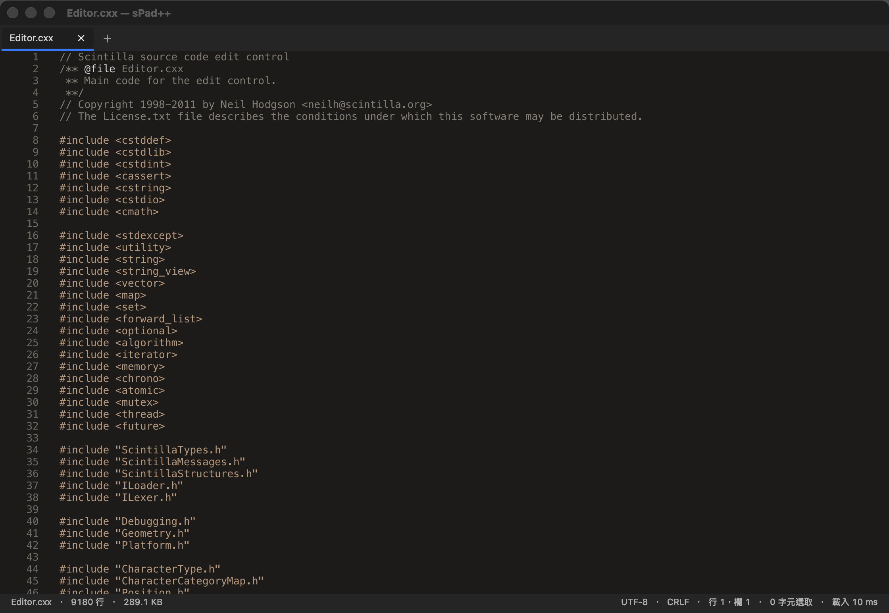

# sPad++

用 [Scintilla](https://www.scintilla.org/) ＋ [Lexilla](https://www.scintilla.org/Lexilla.html)
當編輯引擎、Cocoa 外殼從零重寫的 **macOS 原生文字編輯器**。

**狀態：早期原型。** 能開檔、編輯、存檔，扛得住 500 MB 的文件，
功能列表如下，但還沒到「每天上班用」的完成度。

> **這不是 fork。** 本專案沒有使用 Notepad++ 的任何程式碼、二進位或資料檔。
> 與 Notepad++ 的關係只有「功能與操作習慣的致敬」，實作完全不同。
> 與 Notepad++ 專案、Don Ho、Scintilla 專案均無隸屬或背書關係。
>
> 註：GitHub 不允許 repo 名稱包含 `+`，所以網址是 `sPadPlusPlus`；
> 產品名稱與 App bundle 仍然是 **sPad++**。



---

## 目前已實作

### 文件與分頁

- 分頁可拖曳排序、超出寬度可橫向捲動、未儲存會有圓點標記
- Session 還原：檔案路徑、游標位置、捲動位置、編碼、主題
- 編碼自動偵測與轉換：UTF-8 / UTF-16、Big5、GB18030、Shift-JIS、
  EUC-JP/KR/TW、windows-1252（使用 [uchardet](https://github.com/BYVoid/uchardet)）
- 換行格式：LF / CRLF / CR 偵測與轉換
- 無損存檔保護：目標編碼無法表示某些字元時會先警告，不會靜默替換成 `?`

### 搜尋

- 尋找／取代面板：即時符合筆數、全部符合項高亮
- 支援 C++11 正規表示式（`SCFIND_CXX11REGEX`）、全字拼寫、大小寫、循環搜尋
- 檔案中尋找：跑在背景佇列、可中途取消、結果表格點兩下直接跳到該行

### 主題

- **6 套內建主題**（我們自己設計，非取自 Notepad++）：
  **墨 Ink**、**夜藍 Midnight**、**終端機 Terminal**（深色）、
  **紙 Paper**、**霧 Mist**、**高對比 Contrast**（淺色／無障礙）
- **格式與 Notepad++ 的 `themes/*.xml` 相容** —— 直接把 NPP 的主題檔丟進
  `~/Library/Application Support/sPad++/themes/`，重新載入就能用
  （已用 NPP 官方 `Obsidian.xml` 實測通過）
- 選單：**顯示 → 主題**；選擇會記住

### 編輯

- 127 個 Lexilla 語法解析器、深色／淺色主題
- 多游標（`⌘D` 加下一個相同、`⇧⌘L` 選取全部相同）
- 欄位（矩形）選取（`Alt` ＋ 拖曳）
- 自動縮排（`{` 之後縮排、`}` 自動退回）、括號配對高亮、選取單字全檔高亮
- 文字自動完成（`⌘Return`）、字級縮放（`⌘=` `⌘-` `⌘0`）
- 顯示空白字元／換行符號
- **書籤**：`⌘F2` 切換、`F2` 下一個、`⇧F2` 上一個（邊界會出現藍色標記）
- **標記全部符合**：`⇧⌘M` 把搜尋結果的每一行標上綠點、`⇧⌘K` 清除

### 尚未支援

外掛、使用者自訂語言（UDL）、文件地圖、函式列表、巨集、列印、分割視窗。

---

## 建置

需求：macOS 11 以上、Xcode Command Line Tools（`xcode-select --install`）。

```bash
git clone https://github.com/tommy1616/sPadPlusPlus.git
cd sPadPlusPlus/macapp
make          # 第一次會一併編譯 Lexilla（127 個 lexer，約 2 分鐘）
open "sPad++.app"
```

產出是 `macapp/sPad++.app`。全部用 clang 編成 arm64，
**沒有 Xcode project、沒有 xib、沒有 Swift**。

診斷用指令：

```bash
./"sPad++.app/Contents/MacOS/sPad++" --bench 檔案.txt   # 載入 / 跳行 / 搜尋耗時
./"sPad++.app/Contents/MacOS/sPad++" --snapshot 輸出.png # 把視窗渲染成 PNG
```

---

## 效能（Apple Silicon，arm64 原生）

| 檔案 | 行數 | 載入 | 跳到檔尾 | 全文掃描 |
|---|---|---|---|---|
| 100 MB | 896,219 | 約 90–180 ms | 約 1 ms | 約 210 ms |
| 500 MB | 5,698,783 | 約 820–2400 ms＊ | 約 1 ms | 約 1.4–2.3 秒 |

＊ 量測時機器負載偏高，最好的一次是 823 ms。
載入是一次 `SCI_ADDTEXT`；上色是增量的，與檔案大小無關。

檔案中尋找：616 個檔案、1182 筆符合、約 800 ms，
期間主執行緒最大延遲 **74 ms**（20 ms 心跳）—— 也就是 UI 沒有被卡住。

---

## 架構

```
macapp/main.mm          約 2,400 行：AppDelegate、分頁、搜尋面板、編碼、session
third_party/scintilla   編輯引擎（Cocoa 平台層：ScintillaView、PlatCocoa）
third_party/lexilla     127 個語法解析器
third_party/uchardet    編碼偵測
```

Notepad++ 的 Win32 層負責的東西——訊息迴圈、對話框、docking、session——
在這裡全部由 Cocoa 外殼接手。Scintilla 透過標準的 `SCI_*` 訊息介面驅動，
編輯核心本身沒有改動。

已知建置問題：Lexilla 的 `LexUser.cxx` 只能在 Windows 編譯，
所以排除它、改連結一個 `lmUserDefine` 的空實作（`macapp/lexer_stub.cxx`）。

---

## 授權

**GPL-3.0-or-later**，完整條文見 [LICENSE](LICENSE)，第三方元件見 [NOTICE](NOTICE)。

選 GPL 是刻意的：保留未來重用 Notepad++ 的 GPL 資料檔（主題、語言定義）
或程式碼的空間，也符合這類編輯器社群的期待。

第三方元件各自維持原有授權：
Scintilla／Lexilla 是寬鬆的 HPND；uchardet 是三選一授權，本專案採 GPL-2.0-or-later。

---

## 致謝

- [Scintilla](https://www.scintilla.org/) 與 [Lexilla](https://www.scintilla.org/Lexilla.html) — Neil Hodgson
- [uchardet](https://github.com/BYVoid/uchardet) — BYVoid 與貢獻者
- 功能與操作習慣的概念來源：[Notepad++](https://notepad-plus-plus.org/) — Don Ho
